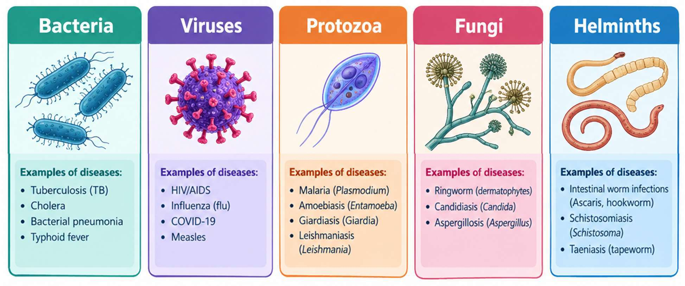

# 02 · Communicable Diseases

## Meaning and transmission

A **communicable disease** is an illness caused by an infectious agent that can be transmitted, directly or indirectly, from a source to a susceptible person. Agents include viruses, bacteria, fungi, and parasites. Infection does not always produce symptoms, and symptoms alone do not identify the cause.

### The chain of infection

Think of spread as a chain: **infectious agent → reservoir/source → exit route → transmission route → entry route → susceptible host**. Prevention interrupts one or more links.

| Route | Examples of interruption |
|---|---|
| Respiratory droplets or aerosols | Ventilation, staying home when ill, appropriate masks, cough etiquette |
| Contaminated food or water (faecal–oral) | Safe water, handwashing, sanitation, food hygiene |
| Blood or sexual contact | Testing, sterile equipment, safer sex, and appropriate protective measures |
| Vectors such as mosquitoes | Removing standing water, nets, repellents, and local vector control |
| Direct contact or contaminated surfaces | Hand hygiene, cleaning, and avoiding shared contaminated items |

## Prevention and response

- **Primary prevention:** reduce the chance of infection (for example vaccination, safe water, or vector control).
- **Early detection and care:** seek qualified assessment, testing, and treatment; follow public-health guidance.
- **Limit further spread:** use appropriate isolation or precautions, inform relevant contacts when advised, and complete prescribed treatment.
- **Community measures:** surveillance, health education, sanitation, access to care, and timely risk communication.

## Exam distinctions

- **Infection** means an infectious agent is present; **disease** refers to illness or harmful effects, though infection may be asymptomatic.
- A **vector** carries an agent between hosts; a **reservoir** is where an agent normally lives or multiplies.
- Antibiotics treat certain bacterial infections, not viral infections; only a qualified clinician should advise treatment.

## Active recall

1. Reproduce the chain of infection and explain two points where spread can be interrupted.
2. Classify handwashing, vaccination, and mosquito-net use as prevention measures and explain what each targets.
3. Why is it unsafe to infer that a disease is bacterial from symptoms alone?
