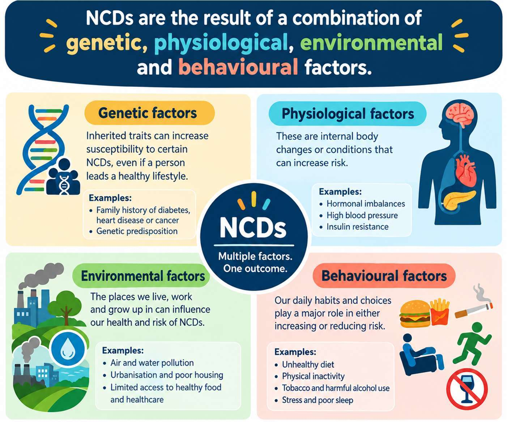

# 03 · Noncommunicable Diseases

## What makes a disease noncommunicable?

**Noncommunicable diseases (NCDs)** are generally long-duration conditions that are not passed from person to person through ordinary infectious transmission. Major groups include cardiovascular diseases, cancers, chronic respiratory diseases, and diabetes. They often result from interacting biological, behavioural, social, commercial, and environmental factors.

## Risk and protection

Risk factors can be **modifiable** (such as tobacco use, harmful alcohol use, inactivity, unhealthy diets, and some environmental exposures) or **non-modifiable** (such as age, inherited susceptibility, or family history). Risk is not blame: income, food access, safe places to exercise, education, and health services shape what choices are available.

### Prevention levels

1. **Population prevention:** make healthier environments easier (clean air, safe activity spaces, health education, and accessible services).
2. **Individual risk reduction:** avoid tobacco, choose feasible nutritious foods and activity, and seek preventive care.
3. **Screening and early diagnosis:** use recommended services; screening is not a diagnosis and should be interpreted by health professionals.
4. **Treatment and long-term support:** follow an agreed care plan and address physical, mental, and social needs.

## A useful exam structure

For an NCD question, define the condition/group, name risk factors and protective actions, explain prevention or management, and acknowledge social determinants. Avoid claiming that one factor inevitably causes disease or that lifestyle alone explains every case.

## Active recall

1. Distinguish an NCD from an infectious disease.
2. Give two modifiable and two non-modifiable risk factors.
3. Explain why screening and diagnosis are not the same thing.
